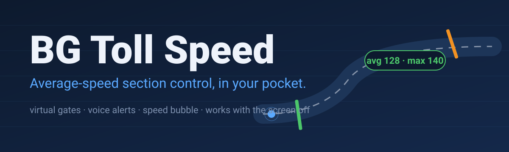
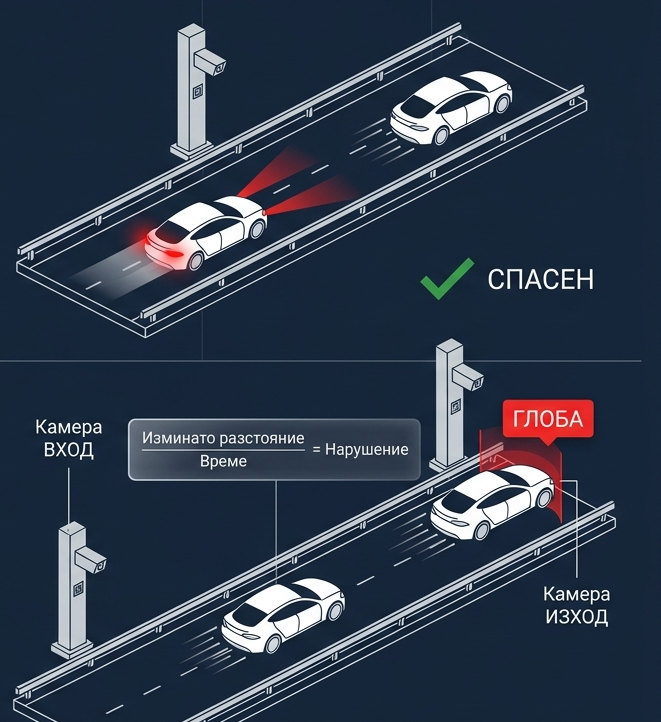
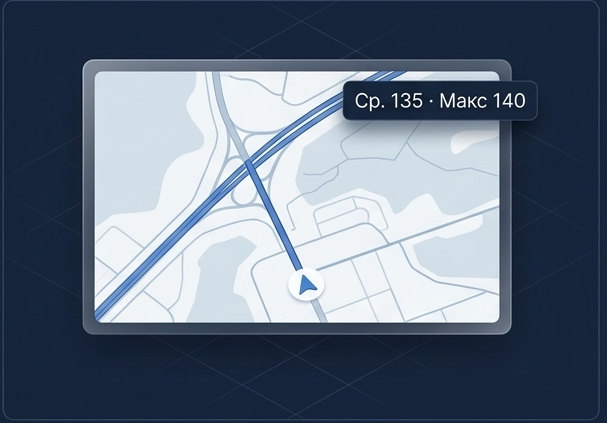
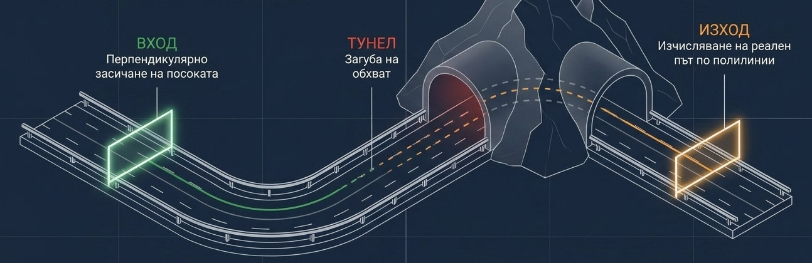

 

**Warns Bulgarian drivers about average-speed sections and tells them how fast they can go.**

> **Showcase repository.** This page presents the product and the engineering behind it. The source code is private.

---

## How it works

Average-speed cameras measure the time between an entry and an exit camera. The app does the same maths on the phone, so the driver sees the average speed and the limit before the exit camera does.

## What it does

| | |
|---|---|
| **Section detection** | Recognises entry and exit of a section by direction and position |
| **Average speed** | Live average, current speed and the maximum you can still hold to the end |
| **Correct limits** | Limits by road type, such as 90 km/h on first-class roads and 140 on motorways |
| **Voice** | Spoken warnings before a section, before its end and a summary at the finish |
| **Speed bubble** | A floating bubble over Google Maps or Waze |
| **Runs in the background** | Keeps tracking with the screen off, in the background and on rotation |
| **Sections across Bulgaria** | Sections and directions stored in the cloud and updated without a new release |

## Engineering

| Area | Approach |
|---|---|
| Detection | Virtual gates: a perpendicular crossing test at entry and exit, real path length along the route polyline, and tunnel handling for lost GPS |
| Tracking | Foreground location service with a dedicated section detector and map controller |
| Data | Firestore repository for sections, with Python scripts that upload and validate new ones |
| Monetisation | Play Billing for a Pro tier, rewarded ads |
| Release | Release notes and store listings in Bulgarian and English |

## Design language

<table>
<tr>
<td bgcolor="#0D1A2E" width="130" align="center"><b>#0D1A2E</b> night</td>
<td bgcolor="#5AA9FF" width="130" align="center"><b>#5AA9FF</b> route blue</td>
<td bgcolor="#4CC76A" width="130" align="center"><b>#4CC76A</b> safe</td>
<td bgcolor="#F39222" width="130" align="center"><b>#F39222</b> caution</td>
<td bgcolor="#E2483F" width="130" align="center"><b>#E2483F</b> over limit</td>
</tr>
</table>

A dashboard look for the car: dark blue background and a traffic-light palette, so one glance says whether you are safe.

---

Built by [@ivaylozhivkov88](https://github.com/ivaylozhivkov88)

